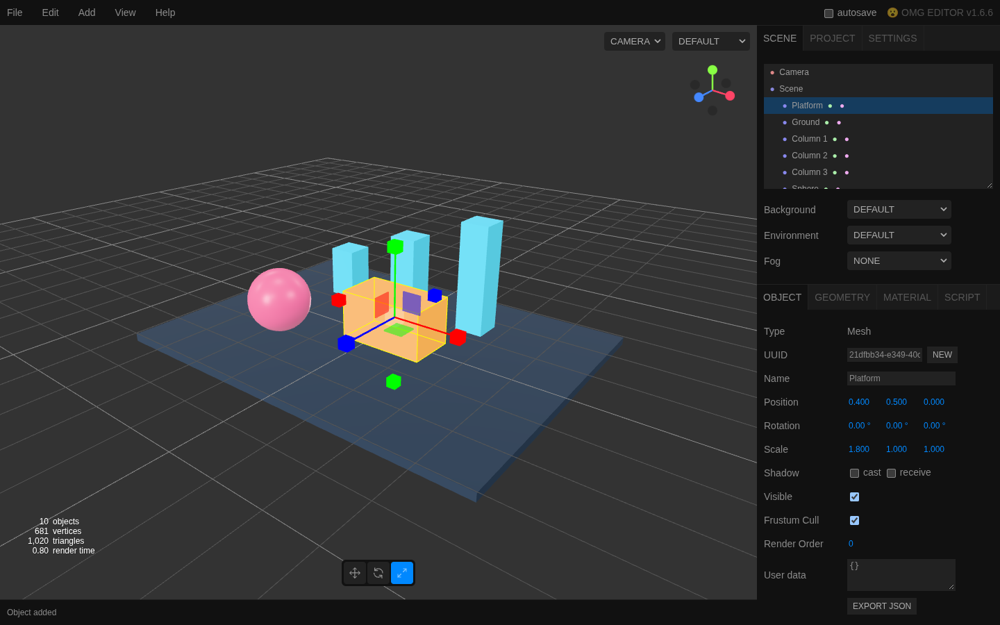

# OMG Editor

A scene and map editor for building small 3D environments, inspecting imported models, and saving reusable Three.js projects. Run it in a browser during development or build a Windows desktop application with native Save As dialogs.

OMG Editor extends the **Three.js editor**. The project-specific work focuses on practical scene editing: one-sided scaling, multi-selection, fly navigation, alignment shortcuts, command history, and a Tauri desktop wrapper. The underlying renderer, many editor panels, and format loaders come from Three.js and its contributors.



[Watch the short browser demonstration](docs/demo.webm): create a box, move it, scale one side, undo/redo, and save JSON. The screenshot and recording show the running application with procedural geometry, not a mockup. A [user-provided capture of an earlier Windows build](docs/screenshots/windows-earlier-version.jpg) shows the editor being used on a larger level; it is not evidence of a current installer test.

## What you can do

- Create groups, primitive meshes, text geometry, lights, and cameras.
- Select objects in the viewport or scene outliner; Alt-click adds or removes objects from a selection. Move, clone, delete, and reparent multiple selected objects.
- Translate, rotate, and scale with gizmos or numeric property fields. Single-axis scaling offsets the object to keep the opposite side in place; hold Alt for scaling around its origin.
- Navigate with orbit/pan/zoom or a WASD fly camera. Focus a selection, center it, or snap it to the ground.
- Edit geometry parameters, materials, texture slots, background, environment, fog, and renderer settings. Switch between default, solid, normals, and wireframe viewport shading.
- Undo and redo through command history, including compound edits. The undo stack retains up to 200 entries; history serialization is optional.
- Save/open complete editor projects as JSON. Browser saves download a file; desktop Save As chooses a native path and subsequent Save writes there.
- Enable optional IndexedDB autosave and restore scenes after a reload. Autosave is off by default; preferences use localStorage.
- Attach JavaScript source to objects with CodeMirror syntax highlighting and Tern completion. The inherited Project → Publish control exports a standalone HTML ZIP; it does not upload to a service.

## Formats

Project JSON preserves the editor scene, camera, scripts, and optional history. Its scene section uses Three.js ObjectLoader serialization; the complete project is an editor envelope, not a bare ObjectLoader scene.

| Operation | Implemented formats |
| --- | --- |
| Common model imports | GLTF/GLB, FBX, OBJ, Collada/DAE, STL, PLY, USD/USDZ |
| Additional loader branches | 3DM, 3DS, 3MF, AMF, DRC, KMZ, MD2, PCD, SVG, VOX, VTK/VTP, VRML/WRL, XYZ, selected ZIP contents |
| Exports | GLTF/GLB, OBJ, DRC, PLY (text/binary), STL (text/binary), USDZ, project JSON |
| Textures | Material texture inputs accept common browser images and TGA; glTF can use bundled Draco/Basis decoders |

These are implemented loader/exporter paths, not a claim that every format has been tested. OBJ import and GLB export are covered by the browser suite. Import related files together so the loading manager can resolve local resources. LDraw loader branches remain in source, but its external part library is not bundled; LDraw is not a ready-to-use supported workflow. Legacy executable `.js` model imports are disabled.

## Run locally

Use **Node.js 24 LTS**, npm, and a modern browser with WebGL support. The frontend requires Node 22.12 or newer. No account, API key, environment file, or backend is needed.

```sh
git clone https://github.com/NukeItGames/OMG-Editor-Portfolio.git
cd OMG-Editor-Portfolio
npm ci
npm run dev
```

Open the loopback URL printed by Vite, normally http://127.0.0.1:5173. The dev server uses a fixed port so Tauri can reach it. To inspect the production build:

```sh
npm run build
npm run preview
```

Open http://localhost:4173. `dist/` contains the web build. The preparation script copies the raw files required by the standalone exporter, examples, and library notices into the build; generated runtime files are not committed.

## Windows desktop build

Install [Tauri's Windows prerequisites](https://v2.tauri.app/start/prerequisites/): Microsoft C++ Build Tools with the Desktop development with C++ workload and Windows SDK, the WebView2 runtime, and Rust via rustup. Use a current stable Rust MSVC toolchain, **Rust 1.90 or newer** for the resolved dependencies.

From PowerShell in the cloned repository:

```powershell
npm ci
rustup default stable-msvc
npm run tauri -- dev
# Production NSIS installer:
npm run tauri -- build --bundles nsis
```

The installer is written to `src-tauri/target/release/bundle/nsis/`. It is unsigned; no signing key or certificate is included. The CI workflow builds an unsigned Windows installer as an Actions artifact. See [validation results](docs/VALIDATION.md) for what actually ran; a build artifact alone does not establish that installation or native dialogs work on a user's machine.

The portfolio uses its own application identifier so its desktop storage is separate from the original application. Native permissions cover window close, process exit, dialogs, and text writes to paths selected through the dialog. There is no shell plugin or custom command for unrestricted filesystem access.

## Architecture

```text
index.html                 Startup and component composition
js/Editor.js               Scene state, object/material registries, signals, serialization
js/Viewport.js             Rendering, selection display, transforms, one-sided scaling
js/EditorControls.js       Orbit and fly camera navigation
js/Selector.js             Picking and multi-selection
js/commands/ + History.js  Reversible commands, batching, merging, history serialization
js/Sidebar.*               Object, geometry, material, scene, and project panels
js/Loader.js               Local imports and their resource loading manager
js/Storage.js + Config.js  IndexedDB scene storage and localStorage preferences
public/                    Classic vendor scripts, decoders, font, examples, icons, tones
src-tauri/                 Rust application entry, plugins, window and permission config
tests/                     Playwright acceptance tests against the production build
```

JavaScript owns editing behavior. UI components dispatch signals through the central `Editor`; commands change Three.js objects and notify the viewport and sidebar. History merges compatible continuous edits and groups multi-object operations into one undo step. One-sided scale records both position and scale as a compound command so undo restores the original bounds.

Vite bundles the ES modules and Three.js addons. Classic CodeMirror/Tern/parser scripts are served locally. Rust registers Tauri's dialog, filesystem, process, and debug logging plugins; it does not implement a second scene engine. WebGL is the default renderer. WebGPU is an optional path with a WebGL fallback and is not covered by the acceptance tests.

## Controls and a quick walkthrough

Choose **Add → Mesh → Box**, select **Scale** in the bottom toolbar, and drag an axis handle. Hold Alt before a drag to scale around the origin. Use **Edit → Undo/Redo** to inspect the compound history entry. Choose **File → Save** in a browser or **Save As** on desktop, then **File → Open** to reload the JSON.

| Input | Action |
| --- | --- |
| Left drag / right drag / wheel | Orbit / pan / zoom |
| WASD, Q/E, Shift | Fly camera, vertical movement, faster movement |
| W / E / R | Translate / rotate / scale mode |
| Alt-click | Toggle object in multi-selection |
| F / G / Y | Focus / center / snap to ground |
| Ctrl+D / Delete | Clone / delete selection |
| Ctrl+Z / Ctrl+Shift+Z | Undo / redo |

On macOS, history and clone shortcuts use Command. Ctrl+X is also retained as a legacy redo shortcut. Transform and fly-navigation defaults overlap; the toolbar avoids mode ambiguity. Shortcut settings allow changing the transform/focus bindings.

## Validation and limitations

```sh
npm run check            # Application JavaScript syntax, not a full lint/type analysis
npm run build
npx playwright install chromium
npm test                # Starts a production preview automatically
npm audit
cargo audit --file src-tauri/Cargo.lock
```

Playwright may require `npx playwright install --with-deps chromium` on a minimal Linux system. To use an installed Chromium, set `PLAYWRIGHT_CHROMIUM_EXECUTABLE` to its executable path. There is no TypeScript project or configured ESLint suite. [Validation](docs/VALIDATION.md) records executed checks, failures, fixes, and platform limits; [the publication audit](docs/AUDIT.md) records security and licensing decisions.

This is a scene-authoring tool, with no physics engine, animation timeline, multiplayer, cloud sync, AI integration, or in-editor game playback. Importing an animated model does not add timeline editing. Large scenes and malformed assets can exhaust browser memory; import size limits and parser isolation are not implemented. One-sided scaling is designed for centered mesh geometry; groups, off-center geometry, and complex transformed parents need manual checking.

Autosave is a local convenience, not a backup. It is not encrypted, and clearing site/app data removes it. Keep explicit JSON backups. Unsaved-change prompts and exhaustive corrupt-project recovery are not implemented. The standalone HTML export executes project scripts as ordinary trusted JavaScript; its variable shadowing is **not a security sandbox**. Review scripts before running exported projects. Importers may request URLs referenced by assets in the web version; the desktop CSP restricts remote loads. No telemetry or hosted service is configured.

Windows is the desktop target documented here. Linux builds need GTK/WebKit development libraries and were blocked in the preparation environment. A local GLib dependency carries the exact upstream safety backport described in `src-tauri/vendor/glib/PORTFOLIO-PATCH.md`. One transitive build macro crate remains unmaintained. There is no offline web reload guarantee, and accessibility, all file formats, WebGPU, and physical desktop workflows require broader QA.

## License and credits

Application code retains the existing **MIT** license and Three.js copyright notice. OMG Editor is a Three.js editor derivative maintained by NukeItGames. See [LICENSE](LICENSE), [third-party notices](THIRD_PARTY_NOTICES.md), and [dependency licenses](docs/DEPENDENCIES.csv). Decoder binaries, fonts, and the user-supplied screenshot keep their separate terms; the code license does not claim ownership of them.
